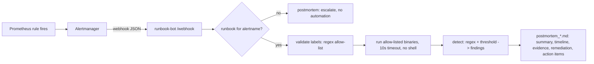

# runbook-bot: alert → diagnostics → Markdown postmortem

> **Lab project.** The alerts in `samples/` are synthetic. Diagnostics run against whatever host the bot runs on (in my results that was my lab box, not a production server).

## Problem
At 3 a.m. the on-call engineer gets `HostDiskFull`, opens the wiki runbook, and pastes `df -h` and `du` by hand. Then, a day later, they write the postmortem from memory. runbook-bot receives the **Alertmanager webhook**, picks the matching **YAML runbook**, runs its **allow-listed** diagnostic commands with timeouts, applies threshold rules to the output, and writes a **pre-filled Markdown postmortem** with the timeline, raw evidence, findings and remediation already filled in.

## Architecture


## Layout
| Path | What |
|---|---|
| `runbookbot/core.py` | runbook loading, safe command rendering, step runner, postmortem template |
| `runbookbot/server.py` | FastAPI webhook (Alertmanager v4 payload) |
| `runbookbot/cli.py` | offline mode: payload file → postmortems |
| `runbooks/*.yml` | 4 runbooks: disk, load, memory (PSI), service down |
| `deploy/alertmanager.yml` | Alertmanager receiver wired to the bot |
| `tests/` | 8 pytest tests, including command-injection cases |

## Run
```bash
python3 -m venv .venv && .venv/bin/pip install -r requirements.txt
.venv/bin/pytest -q
.venv/bin/python -m runbookbot.cli samples/alertmanager_payload.json -o results
.venv/bin/uvicorn runbookbot.server:app --port 8000   # then POST the sample to /webhook
docker compose up --build                                # bot + Alertmanager
```

## Results (actual run, 2026-10-11, lab box)
- `pytest`: **8 passed** (`results/pytest.log`).
- CLI on the 5-alert sample (`results/run.log`): 4 alerts matched runbooks and ran 11 diagnostic steps. The 5th (`CertExpiry`) had no runbook and produced an "escalate" postmortem. Every step finished in under 10 ms.
- The box was healthy, so there were **0 threshold findings**: `/` below 85%, memory PSI avg10 = 0.77, load below 4. The detection logic is covered by unit tests with breaching output.
- Injection test: the label `mountpoint="$(id)"` is blocked with rc 126 and is never executed.
- Sample postmortems: `results/postmortem_*.md`.

**Not run:** the Docker image and the compose stack with a live Alertmanager (the box has no Docker). The CI workflow builds the image.

## Limitations
- Diagnostics run on the bot's own host. In production you'd run them on the target over SSH or an agent (Ansible ad-hoc, SSM Run Command) using the `instance` label.
- No auth on `/webhook`. Put it behind a network policy or a shared-secret header.
- Root cause and action items are left for a human on purpose. The bot collects evidence; it doesn't guess causes.
- Thresholds are regex-based and fragile across `df`/`ps` versions.

## Sources
- Alertmanager webhook payload: https://prometheus.io/docs/alerting/latest/configuration/#webhook_config
- Google SRE book, Postmortem Culture: https://sre.google/sre-book/postmortem-culture/
- Linux PSI: https://docs.kernel.org/accounting/psi.html
